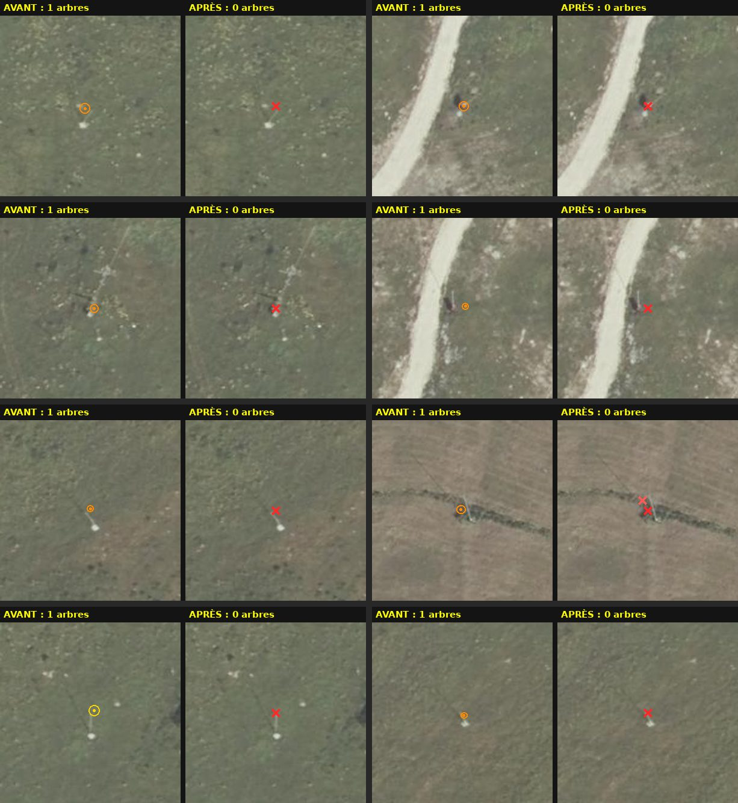
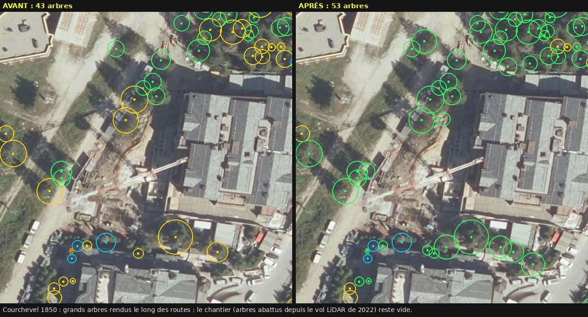
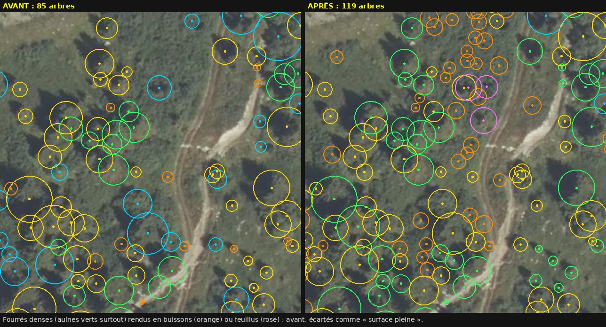

# Arbres du Relief HD : placement, essences, tailles (26/11/2026)

Retour d'Edgar du 25/11 au soir : « il peut y avoir des petits arbres un peu pas au bon endroit : j'en ai vu un au milieu
d'une piste… Parfois ça manque de densité : on voit sur la carte ortho IGN qu'il y a des arbres alors que chez nous il y en
a 2 ou 3 » ; et « voir si on est vraiment au top niveau type d'essence, taille, etc. ».

Travail fait sur un échantillon seulement, sur une machine du cloud : **le workflow `relief-hd.yml` n'a pas été lancé, rien
n'est parti sur R2.** Code : `relief-hd/arbres.py` (format des fichiers inchangé, cf. § 6). Images : `relief-hd/arbres-26-11/`.

## 1. En bref

Sur 8 blocs z16 autour de Courchevel 1850 (pistes, forêt dense, lisières, village, arbres isolés) :

| | avant | après |
|---|---:|---:|
| arbres | 13 320 | 13 703 |
| « arbres » retirés : perches et canons à neige, poteaux, cheminée | — | 48 (dont 34 seuls au milieu d'une piste ou d'un pré) |
| vrais arbres de 6 m et plus rendus (surtout ceux qu'écartait l'infrarouge) | — | 127 (dont 58 dans le village) |
| fourrés denses rendus (aulnes verts surtout, en buissons ou feuillus) | — | 242 |
| arbres écartés par l'infrarouge (dans les blocs) | 208 | 71 |
| hauteur médiane | 16,7 m | 17,5 m (cime mesurée, cf. § 4.4) |
| épicéas / mélèzes / pins / feuillus / buissons | 9 180 / 3 141 / 498 / 0 / 501 | 11 080 / 2 086 / 193 / 18 / 326 |

Blocs témoins : paroi sous l'Aiguille du Fruit (33975/23481) 0 → 0 arbre ; lac de l'Aiguille du Fruit (33971/23485, 2 180 m)
128 → 169 (petits conifères et buissons de la limite de la forêt, vérifiés sur fiches) ; pinède pure de la BD Forêt
(33982/23466) : 25 pins n'y sont plus pris pour des pylônes.

Le « petit arbre au milieu d'une piste » : presque toujours une **perche ou un canon à neige** (image 1).

## 2. Échantillon et sources

- Blocs z16 : 33973/23469, 33973/23470, 33974/23468, 33974/23469, 33974/23470, 33975/23468 (village), 33976/23466,
  33977/23469 ; témoins : 33971/23485, 33975/23481 ; références d'essences : 33974/23463 (mélèze pur, Courchevel),
  33951/23470 (mélèze pur, côté Méribel), 33982/23466 (pin à crochets ou cembro pur).
- LiDAR HD de l'IGN : **volé le 15/07/2022** (heure GPS des points), ~27 points/m².
- Photo de comparaison : BD ORTHO de l'IGN (Géoplateforme, WMTS public), **vols des 23/08, 30/08 et 07/09/2024**, 20 cm
  (graphe de mosaïquage). Deux ans d'écart : arbres abattus (chantiers du village), jeunes arbres qui ont poussé.
- Photo infrarouge (ORTHOIMAGERY.ORTHOPHOTOS.IRC) et BD Forêt V2, comme avant.

Méthode : pour chaque type d'erreur, « fiches » arbre par arbre (photo 20 cm, vue de dessus des points LiDAR par classe,
profil de côté), puis règle mesurée sur les 8 blocs, puis nouvelles fiches sur ce que la règle change.

## 3. Comment `arbres.py` place les arbres (rappel)

1. Modèle de hauteur de canopée (MHC) à 0,5 m : écho de végétation le plus haut (classes 3, 4, 5) moins le sol, lissé
   (gaussienne σ ≈ 0,5 m).
2. Sommets : maxima locaux du MHC lissé, fenêtre qui grandit avec la hauteur (rayon 1 m sous 6 m, 1,5 m jusqu'à 14 m,
   2 m jusqu'à 25 m, 2,6 m au-delà), à partir de 2 m.
3. Couronnes : ligne de partage des eaux autour des sommets (cases de plus de 1,5 m) ; rayon = √(surface / π).
4. Écartés : couronne suspendue (câbles), un seul écho (rocher, toit), paroi (sol > 50°), pylône, non végétale sur
   l'infrarouge, couloir de 5 m sous les remontées de la BD TOPO.
5. Essence : BD Forêt (parcelles pures), sinon forme de la couronne (rayon / hauteur) et altitude ; buisson sous 3 m.

## 4. Ce qui a été mesuré face à la photo, et corrigé

### 4.1 Perches et canons à neige pris pour de petits arbres (le « petit arbre au milieu d'une piste »)

Sur les pistes, les perches d'enneigement (tubes blancs de 6 à 10 m, inclinés), les canons sur pied, les poteaux laissent
quelques échos en ligne, classés « végétation » par l'IGN. Le MHC lissé n'en garde qu'un petit pic : ils devenaient des
arbres ou buissons de 2 à 4 m, seuls en pleine piste. Signature mesurée : **sommet lissé / écho le plus haut**. Un houppier
en garde 0,75 à 0,95 (médianes 0,74 sous 3 m, 0,89 de 6 à 10 m, 0,96 au-delà de 20 m) ; une perche moins de 0,5. Sur les 60
« arbres » sous 0,6 des 8 blocs, vérifiés un par un sur fiches : presque tous des canons et perches (tube blanc sur la photo,
ligne oblique dans le profil), quelques bords de toit, une cheminée.

Règle **POINTE** (4 octies) : sommet de moins de 10 m dont le rapport est sous 0,5, ou sous 0,65 si ses échos tiennent dans
0,2 m d'écart-type (objet fin). Frontière vérifiée sur fiches : 8 objets sur 10 sont des équipements ou des bords de toit,
2 sont peut-être de jeunes conifères très fins (perte acceptée). Résultat : 48 arbres d'avant retirés, dont 46 pointes.



### 4.2 Vrais arbres écartés par l'infrarouge (village, lisières le long des routes et des pistes)

La règle infrarouge (22/11) lisait la photo **à la place mesurée par le LiDAR**. Or la photo de l'IGN n'est pas une
« vraie ortho » : la cime d'un arbre y est déplacée de 0,2 à 0,4 × sa hauteur (5 à 8 m pour un épicéa de 20 m). À côté
d'une route ou d'un toit, la photo montrait donc le goudron ou le toit : 11 fiches sur 12 des arbres écartés étaient de
vrais épicéas de 13 à 24 m (image 5). 80 % des arbres écartés ainsi mesuraient plus de 8 m, avec un profil d'arbre net.

Correction (4 ter revu) : un arbre que le cœur de la couronne dit « non végétal » est **repris** si la photo montre de la
végétation éclairée à portée du dévers (0,6 × rayon + 0,4 × hauteur) **et** si l'arbre a son **ombre portée** sur la
photo (luminosité le long de l'ombre prévue, direction du soleil cherchée sur chaque bloc). L'ombre est indispensable : sans
elle, les arbres abattus depuis 2022 sur les chantiers du village revenaient (les pelouses voisines suffisaient). Arbres
gardés au village : 95 % sous 85 de luminosité d'ombre, 99 % sous 104 ; seuil 100. Le chantier reste vide (image 2), les
grues, balcons, voitures et bords de toits restent écartés. Écartés par l'infrarouge dans les 8 blocs : 208 → 71.



### 4.3 Fourrés denses (aulnes verts) écartés comme « surface pleine »

La règle « un seul écho » (moins de 35 % d'échos multiples : rocher, toit) écartait aussi les fourrés denses à feuilles,
que le laser ne traverse pas : profil en dôme de 2 à 4 m, larges de 4 à 8 m. Leur indice infrarouge est **plus végétal**
que celui des conifères (médiane +0,06 à +0,13 hors du village, conifères gardés ~0) ; dans le village il est négatif
(−0,17 : toits, murs). C'est une bonne part du « manque de densité » vu à côté de la photo (taches sombres sans arbre).

Correction (4 septies) : couronne à un seul écho gardée si son cœur est nettement végétal (indice > +0,03, photo assez
claire) ; large et plate (rayon ≥ 0,4 × hauteur, aulnaies : 0,5 à 0,7) → buisson (feuillu au-delà de 5 m) ; étroite
(petits conifères serrés posés sur l'herbe, vers 2 000 m) → règle commune. 9 fiches sur 9 vérifiées végétales.



### 4.4 Hauteurs ~1 m trop basses

La hauteur écrite était le sommet du MHC **lissé**, qui rabote la cime pointue : mesuré sur les 8 blocs, l'écho le plus
haut de la couronne dépasse le sommet lissé de 0,9 m (moins de 4 m), 1,0 m (6 à 20 m), 1,05 m (au-delà) ; un épicéa de 3 m
était rendu à 2,1 m (−25 %). Correction : **hauteur = écho de végétation le plus haut de la couronne à moins de 1,5 m du
sommet**. Les seuils de forme (rayon / hauteur) restent calculés sur la hauteur lissée, pour lesquels ils avaient été
réglés. (Le LiDAR rate lui-même souvent la toute pointe de quelques dizaines de centimètres : rien n'est ajouté pour ça.)

### 4.5 Pins pris pour des pylônes

Le profil « pylône » (échos en haut, mât maigre) est aussi celui des pins (houppier en haut, tronc nu). Pinède pure de la
BD Forêt sans aucune remontée (33982/23466) : 25 « pylônes » écartés, 9 sur 9 vérifiés de vrais pins. Correction
(4 nonies) : un profil de pylône n'est écarté qu'à moins de 30 m d'une remontée ou d'une ligne électrique de la BD TOPO
(sans réponse du service : écarté comme avant). Les 13 pylônes mesurés le 23/11 l'avaient été sur des blocs de remontées.

### 4.6 Vérifié, laissé tel quel

- **Végétation de 1 à 2 m** (petites taches sombres de la photo, genévriers, rhododendrons, jeunes arbres) : 160 à 230
  sommets par bloc en plus si on descendait le seuil ; sur fiches, surtout quelques échos épars dans les prés (bruit),
  peu de vrais buissons. Non ajoutés : ce serait de la densité inventée.
- **Petits arbres isolés** (2 à 5 m) dans les prés au-dessus de 1 850 m : sur fiches, presque tous de vrais jeunes
  conifères (les autres : des perches, désormais écartées).
- **Suspendus** : des câbles, bien écartés.
- **Couloir sous les remontées** (5 m, validé par Edgar le 23/11) : quelques vrais arbres en bord de couloir y passent.
- **Rayons de couronne** : cohérents avec la photo en forêt ; non retouchés.

## 5. Essences et tailles

### 5.1 D'où elles viennent

- **BD Forêt V2** (IGN) : type de peuplement de chaque parcelle (photo-interprétation, « pur » = 75 % au moins de l'essence).
  À Courchevel (zone des 6 tuiles z12) : formation herbacée (LA6, 11 180 ha), sapin ou épicéa (FF2G61, 8 553 ha), mélange
  de feuillus (3 944 ha), lande (LA4, 3 609 ha), mélanges, pin à crochets ou cembro pur (FF2G58, 329 ha), mélèze pur
  (FF2-63, 25 ha seulement). (Attention : LA6 est la formation herbacée et LA4 la lande, pas l'inverse.)
- **Forme** (rayon / hauteur) et **altitude** hors des parcelles pures.
- **Hauteur et rayon** : mesurés par le LiDAR (rayon = surface de la couronne).

### 5.2 Ce que disent les mesures (arbres de 6 m et plus des parcelles pures)

| parcelle pure | rayon / hauteur | indice infrarouge du cœur |
|---|---:|---:|
| épicéa (FF2G61, Courchevel) | 0,17 | −0,01 (10 % → 90 % : −0,09 → +0,05) |
| mélèze (FF2-63, 33974/23463, même vol) | 0,19 | +0,075 (+0,03 → +0,12) |
| pin à crochets ou cembro (FF2G58) | 0,25 | −0,05 |
| mélèze (FF2-63, Méribel, autre vol) | 0,19 | +0,27 |
| feuillus (FF1, Méribel) | 0,22 | +0,32 |

La **forme ne distingue pas le mélèze de l'épicéa** (0,19 contre 0,17). La règle « rayon / hauteur ≥ 0,22 → mélèze » rangeait
en mélèzes presque tous les épicéas des zones ouvertes : 554 des 674 arbres de 5 m et plus du bloc 33973/23469, presque
tous sombres et en étoile sur la photo (image 4 ; image 6 : références). L'**infrarouge**, lui, sépare : au-dessus de la
référence des épicéas purs + 0,05 : 78 % des mélèzes purs reconnus, 9 % des épicéas pris pour des mélèzes.

### 5.3 Corrigé

- **Mélèze d'après l'infrarouge** (4 decies), hors des parcelles pures seulement (mélanges, forêts ouvertes, landes, prés,
  hors BD Forêt) : mélèze si l'indice du cœur dépasse de 0,05 la **référence du bloc** (médiane des épicéas purs de 6 m et
  plus du bloc, 30 au moins ; sinon de tous ses arbres de 6 m et plus hors mélèze, pin et feuillus purs ; sans référence ni
  photo : la forme, comme avant). Référence relative parce que l'étalonnage change d'un vol à l'autre (mélèzes purs +0,075
  à Courchevel, +0,27 côté Méribel). Très infrarouge en mélange à feuillus (FF31, FO3) ou en bas (< 1 450 m, couronne
  large) : feuillu. Mélèzes des 8 blocs : 3 141 → 2 086 (2 237 « mélèzes » rendus aux épicéas, 657 épicéas et 341 « pins »
  très infrarouges passés en mélèzes). `ARBRES_ESSENCE_FORME=1` remet l'ancienne règle pour comparer.
- **Pin sylvestre pur** (FF2-52) : rangé en pin (il passait par la forme seule).
- **Hauteur mesurée** (§ 4.4) ; arbres de 2 à 3 m qui passent au-dessus de 3 m : conifères au lieu de buissons.
- Pins des zones ouvertes : 498 → 193 (la règle de forme du pin est inchangée ; une partie des « pins » larges et très
  infrarouges est devenue mélèze).

Limite honnête : le mélèze reste **approché** (8 sur 10 environ) ; à 20 cm, mélèze et épicéa se départagent mal à l'œil
dans le village (fiches mêlées). Le côté « épicéa » de la nouvelle règle est, lui, nettement confirmé par la photo.

### 5.4 Proposé (pas fait)

1. **Mélèze par la saison (Sentinel-2)** : le mélèze jaunit fin octobre et perd ses aiguilles ; une image d'été et une de
   fin octobre (10 m, Copernicus, gratuites ; le dépôt a déjà le miroir Sentinel-2 de la neige) donneraient une carte de
   « part de mélèze » fiable, à croiser avec l'infrarouge par arbre. C'est le meilleur levier pour les essences.
2. **Recaler la photo sur le LiDAR** bloc par bloc (dévers estimé, comme l'ombre l'est déjà) : la couleur et l'infrarouge
   de chaque arbre seraient lus sur SA couronne, pas à côté ; meilleur mélèze, et teinte de rendu plus juste.
3. **Pin cembro** : la forme ne le sépare pas bien (règle inchangée). Indices à mesurer : houppier dense et arrondi,
   sommets multiples, infrarouge plus bas que l'épicéa (−0,05). Il faudrait des parcelles de cembro connues (ONF) pour régler.
4. **Sapin** : la BD Forêt ne le distingue pas de l'épicéa (« sapin ou épicéa ») ; à 1 850 m il est rare. Rien à gagner ici
   pour Courchevel ; à revoir pour les Préalpes (sapinières de basse altitude).
5. **Aulne vert** comme essence à part : aujourd'hui « buisson » (sorte 4, atlas des feuillus). Une sorte 5 « aulne vert »
   demanderait l'app (cf. § 6) et un atlas.
6. **Hauteur de la base du houppier** (mesurable : premier étage d'échos sous la couronne) : utile au rendu des troncs nus
   (pins, mélèzes, grands épicéas) ; demande un champ de plus dans le format.

## 6. Format des fichiers (inchangé)

- `16_<x>_<y>.arb` : même format (en-tête JSON d'une ligne, puis x, y, z, hauteur, rayon en f32 × 5, nature u8, graine u8).
  Lu à l'identique par `paquet-build.mjs` (contrôlé sur les blocs de l'échantillon) ; paquets `.sra` et app inchangés.
- Natures inchangées : 0 épicéa / sapin, 1 mélèze, 2 pin, 3 feuillu, 4 buisson (shared/core/reliefMesh.ts de l'app).
  Seule la répartition change, et la hauteur (≈ +1 m, maximum 43 m dans l'échantillon, sous la limite de 63,75 m du paquet).
- En-tête JSON : compteurs en plus (`buissons_denses`, `ecartes_pointe`, `reference_meleze`), ignorés par le paquet.
- Pour une sorte 5 (aulne vert…) il faudrait, côté app (`treeTiles.ts`, `treeShaders.ts`) : une essence dans `arbres.json`
  qui la couvre (sinon le modèle 3D la dessine comme un buisson, branche « else » de `crownProfile`) ; le reste suit
  (comptage `kind & 7`).
- Réseau : la BD TOPO `ligne_electrique` est lue en plus (une requête WFS par tuile z14, gardée en cache).
- Temps : 21 à 31 s par bloc (27 à 39 s avant).

## 7. Refaire l'échantillon

```bash
ARBRES_ECARTES=1 python relief-hd/arbres.py 33974 23469 dalles travail
```

`ARBRES_ECARTES=1` écrit à côté les écartés et leur raison (`pointe`, `un_echo`, `infrarouge`, `pylone`…), en Lambert 93.
Avant de fabriquer toute la France : relancer Courchevel en « arbres seulement » (workflow, `arbres_seuls`), puis regarder
dans l'app une piste équipée de canons, le village de 1850 et un versant d'aulnes verts.
